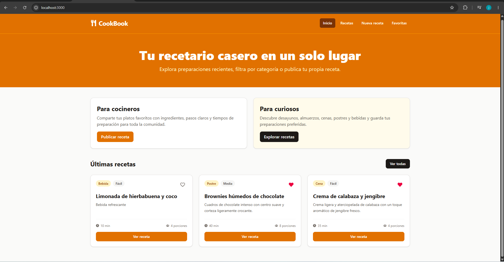
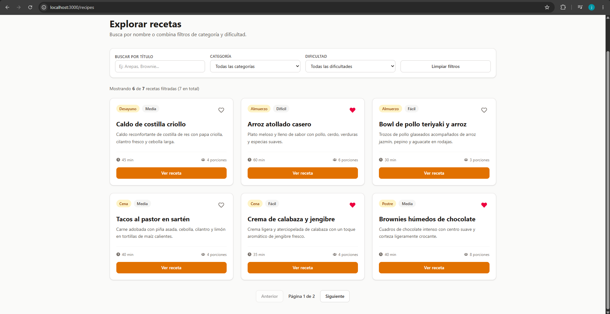
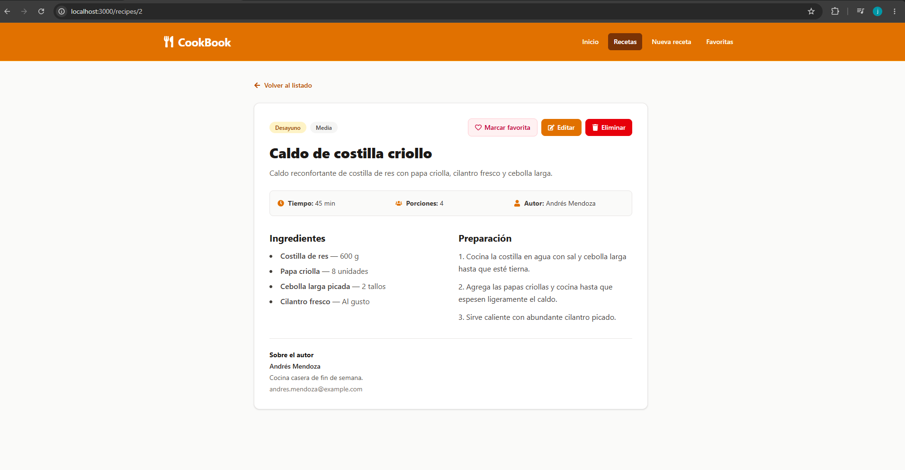
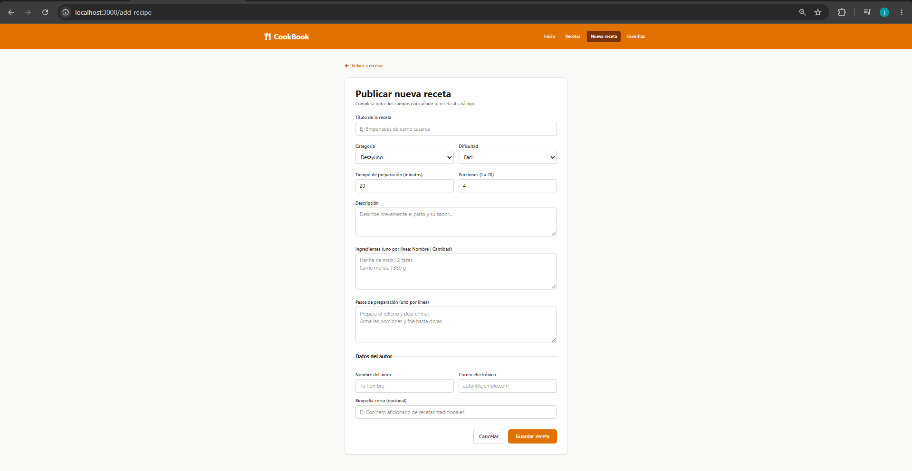

# CookBook

Aplicación web de recetario desarrollada con **React 19**, **Vite**, **Tailwind CSS 4**, **React Router 7** y **json-server** como API REST local. Permite explorar recetas caseras, consultar su detalle completo, crear nuevas preparaciones, editar existentes, eliminar con confirmación, buscar y filtrar de forma combinada, gestionar favoritas persistentes y navegar por páginas.

## Instalación y ejecución

1. Clonar el repositorio e ingresar a la carpeta del proyecto:

   ```bash
   git clone https://github.com/Juan777jr/Proyecto-Recetas-React.git
   cd Proyecto-Recetas-React
   ```

2. Instalar las dependencias:

   ```bash
   npm install
   ```

3. Iniciar el servidor de la API simulada (`json-server` en el puerto `5000`):

   ```bash
   npm run server
   ```

4. En otra terminal, iniciar el servidor de desarrollo de Vite (`http://localhost:3000`, con proxy de `/api` hacia `http://localhost:5000`):

   ```bash
   npm run dev
   ```

5. Ejecutar validaciones de linting y compilación de producción:

   ```bash
   npm run lint
   npm run build
   ```

## Requisitos implementados

### Núcleo obligatorio

- [x] **RF-01 — Layout y navegación**: Estructura principal con `MainLayout`, `Navbar` (`NavLink` con estado activo), `Outlet` y `ToastContainer` de `react-toastify`.
- [x] **RF-02 — Portada (`HomePage`)**: Componente `Hero`, tarjetas reutilizables `Card` ("Para cocineros" y "Para curiosos") con `children` y prop de estilo, visualización de las 3 recetas más recientes y enlace para ver todas.
- [x] **RF-03 — Listado de recetas (`RecipesPage`)**: Carga asíncrona con `useEffect` y `fetch`, indicador `Spinner`, manejo de error visible, estado vacío, `RecipeCard` con `key` estable y descripción expandible ("Ver más / Ver menos") sin `...` en textos cortos.
- [x] **RF-04 — Detalle de receta (`RecipeDetailPage`)**: Carga de datos mediante `loader` de React Router, información completa de la receta, ingredientes, pasos numerados, datos del autor y navegación de regreso.
- [x] **RF-05 — Crear receta (`AddRecipePage`)**: Formulario controlado con `<label>` asociado a cada campo, conversión de valores numéricos (`prepTime` y `servings`), objeto `author` anidado, petición `POST` y espera de respuesta del servidor antes de notificar y redirigir.
- [x] **RF-06 — Editar receta (`EditRecipePage`)**: Carga previa de la receta mediante `loader`, formulario precargado, actualización con `PUT` y retorno al detalle con los cambios reflejados.
- [x] **RF-07 — Eliminar receta**: Confirmación previa antes de borrar, petición `DELETE`, notificación con toast y redirección al listado actualizado.
- [x] **RF-08 — Manejo de errores de ruta (`404` y `errorElement`)**: Página `NotFoundPage` para rutas inexistentes y `errorElement` amigable ante recetas no encontradas (como `/recipes/9999`) o fallos de carga.
- [x] **RF-09 — Diseño responsivo**: Interfaz adaptada a distintos tamaños de pantalla usando utilidades de Tailwind CSS 4.

### Funcionalidades intermedias y retos React 19

- [x] **RF-10 — Búsqueda y filtros combinables**: Búsqueda por título y filtros por categoría y dificultad calculados como estado derivado en cada render (sin duplicar listas filtradas en estados adicionales).
- [x] **RF-12 — Favoritas persistentes**: Marcado y desmarcado de favoritas persistido en `db.json` mediante peticiones `PATCH /api/recipes/:id`, con vista dedicada en `/favorites`.
- [x] **RF-13 — Validación de formularios**: Mensajes de error claros debajo de cada campo (tiempo entero mayor a `0`, porciones entre `1` y `20`, correo electrónico válido, al menos un ingrediente y un paso).
- [x] **RF-14 — Paginación**: Paginación sobre el listado ya filtrado con botones **Anterior** y **Siguiente** e indicador de página actual.
- [x] **RT-05 — Metadatos por página**: Títulos de documento (`<title>`) definidos de forma declarativa en cada vista.
- [x] **RT-06 — `ref` como prop normal en React 19**: Componente reutilizable `Input` que recibe `ref` directamente como prop estándar (sin `forwardRef`) y enfoca el primer campo con error al validar.

## Decisiones técnicas

- **Persistencia de favoritas en el servidor (`PATCH /api/recipes/:id`)**: Se decidió guardar el estado `favorite` directamente en `db.json` mediante peticiones `PATCH` en lugar de usar solo `localStorage`, manteniendo una única fuente de verdad en la API y permitiendo reflejar el estado en portada, listado, detalle y `/favorites`.
- **Estado derivado para búsqueda, filtros y paginación**: `filteredRecipes` y `paginatedRecipes` se calculan a partir del estado base (`recipes`, `search`, `category`, `difficulty`, `currentPage`) durante el render, evitando sincronizaciones manuales o mutaciones del arreglo original.
- **Centralización de acceso a datos (`src/services/recipesApi.js`)**: Todas las operaciones HTTP (`getRecipes`, `getLatestRecipes`, `getRecipeById`, `createRecipe`, `updateRecipe`, `toggleFavoriteRecipe`, `deleteRecipe`) están encapsuladas en `src/services/recipesApi.js` con verificación explícita de `response.ok`.
- **Adopción de patrones de React 19**: Se implementaron `<title>` por página para actualizar el título de la pestaña según la vista y un componente `Input` pasando `ref` como prop normal.

## Problemas encontrados y soluciones

1. **Rutas duplicadas en `createBrowserRouter` (`src/App.jsx`)**: Al reemplazar marcadores de posición iniciales por componentes definitivos quedaron entradas repetidas para una misma ruta; se limpió la configuración del enrutador dejando una definición única por ruta.
2. **Página actual fuera de rango al cambiar búsqueda o filtros**: Al combinar filtros con paginación, escribir una búsqueda o cambiar categoría/dificultad podía dejar `currentPage` por encima del total de páginas filtradas; se calculó `totalPages` sobre `filteredRecipes` y se reinició la página a `1` al modificar cualquier criterio de filtrado.
3. **Respeto de reglas de ESLint y compilación de producción**: Antes del cierre se verificó el código con `npm run lint` y `npm run build` hasta obtener cero errores, asegurando un componente por archivo, sin mutación de estado y con dependencias limpias en `useEffect`.

## Capturas de pantalla

### Portada


### Listado de recetas


### Detalle de receta


### Formulario de receta
